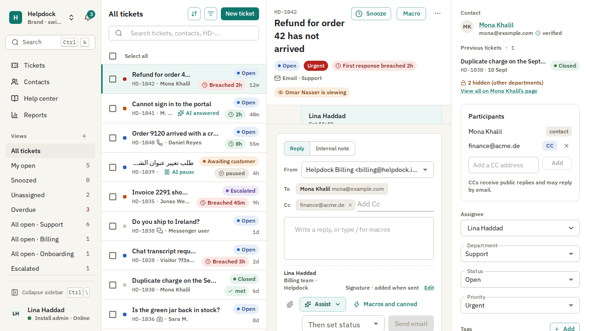
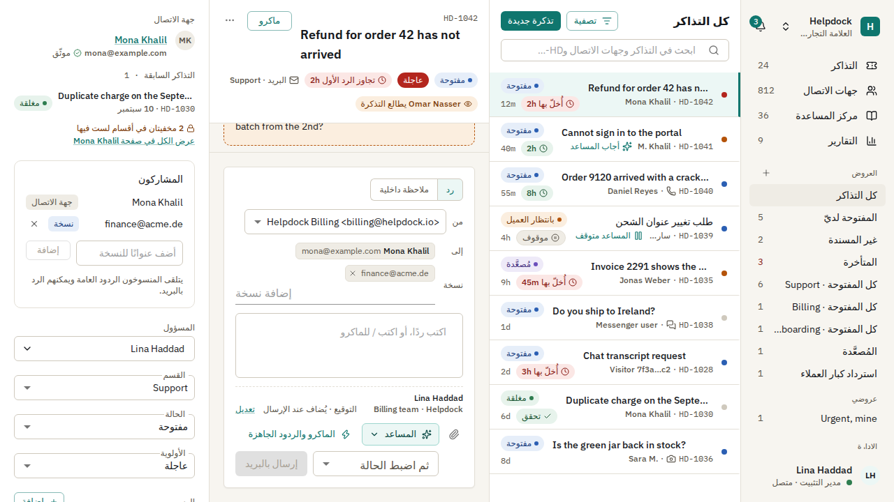
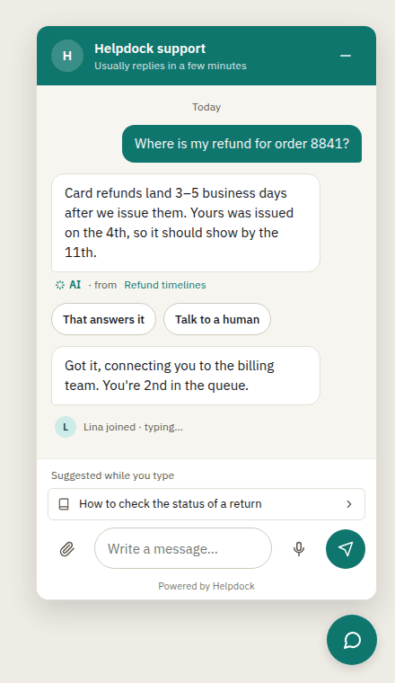
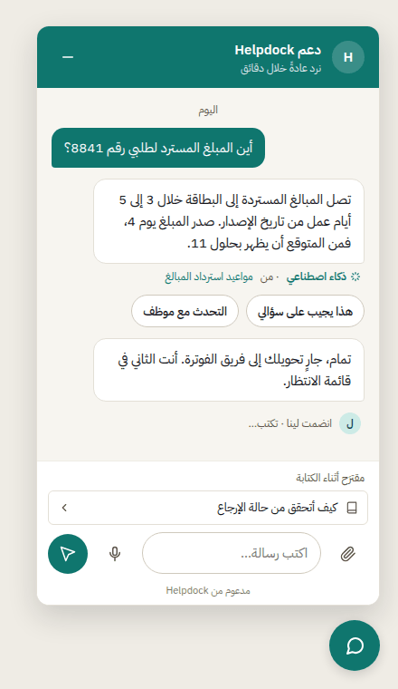

# Helpdock

**Self-hosted customer support: ticketing, a help center, a live chat widget and grounded AI, in one deploy that serves many brands.** An open-source alternative to Zendesk, Freshdesk and Zoho Desk, in English and Arabic.

[](LICENSE)
[](https://github.com/Docker-Hunterpedia/Helpdock/releases)
[](https://github.com/Docker-Hunterpedia/Helpdock/actions/workflows/ci.yml)
[](https://github.com/Docker-Hunterpedia/Helpdock/pkgs/container/helpdock)

[Quick start](#quick-start) · [Features](#features) · [Documentation](#documentation) · [Changelog](CHANGELOG.md) · [Contributing](#contributing)

<p align="center">
  
</p>

<table>
  <tr>
    <td width="50%"></td>
    <td width="25%"></td>
    <td width="25%"></td>
  </tr>
  <tr>
    <td align="center">The ticket workspace in Arabic</td>
    <td align="center" colspan="2">The chat widget in English and Arabic</td>
  </tr>
</table>

<sub>The ticket workspace images are the admin app's screenshot baselines, rendered by Playwright in CI. The widget images are renders of its design artboards; every screen is in [docs/design/](docs/design/README.md).</sub>

## Why Helpdock

- **Your data, your server.** One Docker Compose stack on a Linux host with 2 vCPU and 4 GB of memory, under the AGPL-3.0.
- **One deploy, many brands.** Each brand has its own inboxes, channels, help center on its own domain, widget theme and AI knowledge. Isolation between brands is enforced by Postgres row-level security.
- **Every channel lands in one desk.** Email, Telegram, WhatsApp, Messenger, Instagram, the chat widget, a web form and the REST API all file into the same tickets, with the same statuses, SLAs, rules and assignment.
- **AI that stays inside your knowledge.** The assistant answers only from the brand's knowledge base, cites its sources, and hands the conversation to a person when the knowledge base does not answer.
- **Bilingual from the first screen.** The admin app, help center, widget and emails ship in English and Arabic, with right-to-left layouts.

## Features

### Ticketing, SLAs and automation

- Departments and teams, with department scope enforced in the database.
- Saved views, tags, custom values, participants and CC, internal notes, merge, unmerge and split, linked tickets, spam handling, and a collision indicator when two agents open or reply to the same ticket.
- Business hours with holidays and time zones, and SLA policies whose first-response and resolution clocks pause in the statuses you mark as paused.
- Workflow rules and time-based rules with a test run and an execution log, macros and canned responses with placeholders.
- A CSAT survey when a ticket is closed.
- Notifications in the app, by email and by browser push, and an install-wide audit log.

Guides: [tickets](docs/guides/tickets.md), [ticketing settings](docs/guides/ticketing-settings.md), [business hours and SLAs](docs/guides/slas.md), [automation](docs/guides/automation.md), [macros](docs/guides/macros.md), [notifications](docs/guides/notifications.md).

### Channels

| Channel | How customers reach you | Guide |
|---|---|---|
| Email | A mailbox fetched over IMAP or an inbound-parse webhook; replies go out over the brand's SMTP sender | [Receiving mail](docs/guides/email.md), [outbound email](docs/guides/outbound-email.md) |
| Telegram | The brand's bot | [Telegram](docs/guides/telegram.md) |
| WhatsApp, Messenger, Instagram | The brand's WhatsApp number, Facebook Page or Instagram professional account, through Meta's Graph API | [Meta channels](docs/guides/meta-channels.md) |
| Chat widget | A script on the brand's site, live over WebSocket, with optional signed identity for signed-in users | [Widget protocol](docs/guides/widget-protocol.md) |
| Web form | A hosted contact page on the help center domain | [Web form](docs/guides/web-form.md) |
| REST API | `POST /api/v1/tickets` with a scoped API key | [API](docs/guides/api.md) |

The widget's first script is held to a 40 KB gzipped budget. An overview of every channel is in [channels](docs/guides/channels.md); Slack and Discord are on the [post-1.0 backlog](docs/planning/PRD.md#5-post-10-backlog-v11).

### Help center

- A knowledge base per brand, public or internal-only, served on the brand's own domain with a certificate Caddy issues on demand.
- Articles in English and Arabic, with right-to-left pages, search in each language, and "was this helpful?" feedback.
- Public and internal articles, so the same knowledge serves customers and staff; staff see internal ones with an Internal badge.
- Article proposals: the assistant drafts an article from a closed ticket, and an Admin or Team Leader reviews it before it becomes a draft to edit and publish.

Guide: [help center](docs/guides/help-center.md).

### Grounded AI

- **Answers only from your knowledge**: help center articles, uploaded PDF and DOCX files, crawled websites, Notion and Google Drive. Visitor-facing answers read only public knowledge.
- **Cites its sources**, and drops any citation that does not resolve to a retrieved document.
- **Hands off instead of guessing**: when the knowledge base does not answer the question, or the answer's confidence is below the channel's threshold, the conversation goes to the team.
- Agent assist (suggested replies, summaries, translation), AI triage in workflow rules, and voice-note transcription.
- Any provider pi-ai supports, by API key or subscription, or any OpenAI-compatible server such as Ollama or vLLM. Every mode is off until a brand's Admin turns it on. PII redaction runs before each call, with a prompt-injection filter, per-brand daily and monthly budgets, and a cost log. The model has no tools: it reads knowledge and writes text.

**Recorded evaluation.** Before 1.0.0, the bilingual evaluation passed every threshold in [run 39322685646](https://github.com/Docker-Hunterpedia/Helpdock/actions/runs/39322685646), with `glm-4.6` answering, `glm-5.1` judging and `bge-m3:567m` embeddings: answerable questions answered correctly 97.5 % in English and 94.6 % in Arabic, and unanswerable ones handed off 100 % in both. That is one provider pair; [evaluate the model you choose](docs/guides/ai.md#evaluation).

Guide: [AI](docs/guides/ai.md).

### API, webhooks and reports

- A public REST API with scoped API keys, idempotency keys, cursor pagination and an OpenAPI document generated from the same schemas that validate requests.
- Outbound webhooks with an HMAC signature header, retries, a delivery log and replay.
- Reports on ticket volume, first response and resolution times, SLA compliance, backlog, CSAT, agent workload and help center searches, filtered by date range, department, channel and agent, with CSV export.

Guides: [API](docs/guides/api.md), [webhooks](docs/guides/webhooks.md), [reports](docs/guides/reports.md).

### Staff sign-in and SSO

- Passwords hashed with Argon2id and checked against a breached-password list, a second factor (mandatory for Admins), and magic-link sign-in.
- Staff single sign-on over SAML 2.0 and OpenID Connect, with walk-throughs for Okta, Microsoft Entra ID, Google Workspace and Keycloak.

Guides: [authentication](docs/guides/authentication.md), [SSO](docs/guides/sso.md), [staff and roles](docs/guides/staff-and-roles.md).

### Migration

Importers for Zendesk, Freshdesk and Zoho Desk, and a manual CSV mapper for everything else, with a bilingual wizard, dry-run previews and an explicit approval step. Imported history sends no customer messages and starts no rules, notifications or SLA timers. Guide: [importing](docs/guides/importing.md).

### Security

- Every tenant table carries `brand_id` under a forced row-level security policy, and the api refuses to serve if its database role could bypass it.
- Secrets are encrypted with AES-256-GCM under a master key that is not stored in the database.
- Every fetch of a user-supplied URL goes through an SSRF-safe client; uploads are sniffed by magic bytes, re-encoded, kept in a private bucket and served through short-lived presigned URLs.
- [OWASP ASVS 4.0.3 Level 2](docs/completed/asvs-l2.md) walked requirement by requirement, with no gap open.
- Each release image is built for `linux/amd64` and `linux/arm64`, signed keylessly with Cosign, and published with a CycloneDX SBOM ([verify the signature](docs/guides/release.md#verify-the-image-signature)).

Guides: [security](docs/guides/security.md), [security scanning](docs/guides/security-scanning.md).

## Quick start

You need a Linux server with Docker Engine and the Compose v2 plugin, 2 vCPU and 4 GB of memory, two DNS names pointing at it (one for the admin app, one for the API and widget), ports 80 and 443 open, and an S3-compatible bucket. The commands below install 1.0.0.

```bash
git clone --depth 1 --branch v1.0.0 https://github.com/Docker-Hunterpedia/Helpdock.git
cd Helpdock/docker
cp ../.env.example .env
openssl rand -base64 32   # the master key, for APP_MASTER_KEY
```

Edit `.env` and set at least:

| Key | Value |
|---|---|
| `HELPDOCK_VERSION` | `1.0.0` |
| `APP_URL` | `https://` plus the admin host |
| `APP_MASTER_KEY` | The key you just generated |
| `HELPDOCK_APP_PASSWORD`, `DATABASE_URL` | The runtime database role's password, and the same password inside the URL |
| `POSTGRES_PASSWORD`, `DATABASE_MIGRATION_URL` | The owner role's password, and the same password inside the URL |
| `ADMIN_HOST`, `API_HOST`, `ACME_EMAIL` | Your two hostnames, and the address Caddy registers certificates with |
| `S3_ENDPOINT`, `S3_REGION`, `S3_BUCKET`, `S3_ACCESS_KEY_ID`, `S3_SECRET_ACCESS_KEY` | A private bucket for attachments and article images |

Then start the stack:

```bash
docker compose up -d
docker compose ps
```

Open `https://<ADMIN_HOST>` and finish the first-run wizard. Finish it before anyone else can reach the host, or set a [setup key](docs/guides/install.md#the-setup-key) first.

**Back up `.env` with the database.** Without `APP_MASTER_KEY`, nothing encrypted can be read back.

Next steps: the [install guide](docs/guides/install.md) explains every step, custom domains and running behind Cloudflare or your own proxy; the [configuration reference](docs/guides/configuration.md) lists every key; [operations](docs/guides/operations.md) covers backups, restores, monitoring and master key rotation. To upgrade, follow [Upgrading](docs/guides/operations.md#upgrading): pin the new `HELPDOCK_VERSION`, pull and restart, and the api runs pending migrations when it starts.

## Documentation

| If you want to | Read |
|---|---|
| Install, configure and run it | [Install](docs/guides/install.md), [configuration](docs/guides/configuration.md), [operations](docs/guides/operations.md), [restore drill](docs/guides/restore-drill.md), [performance](docs/guides/performance.md) |
| Set up staff and sign-in | [Authentication](docs/guides/authentication.md), [SSO](docs/guides/sso.md), [staff and roles](docs/guides/staff-and-roles.md), [audit log](docs/guides/audit-log.md) |
| Shape the desk | [Ticketing settings](docs/guides/ticketing-settings.md), [tickets](docs/guides/tickets.md), [SLAs](docs/guides/slas.md), [automation](docs/guides/automation.md), [macros](docs/guides/macros.md), [notifications](docs/guides/notifications.md) |
| Connect channels | [Channels](docs/guides/channels.md), [email](docs/guides/email.md), [outbound email](docs/guides/outbound-email.md), [Telegram](docs/guides/telegram.md), [Meta channels](docs/guides/meta-channels.md), [web form](docs/guides/web-form.md), [widget protocol](docs/guides/widget-protocol.md) |
| Publish knowledge and turn on AI | [Help center](docs/guides/help-center.md), [AI](docs/guides/ai.md) |
| Handle customer data | [Contacts](docs/guides/contacts.md), [attachments](docs/guides/attachments.md), [data retention](docs/guides/data-retention.md) |
| Integrate | [API](docs/guides/api.md), [webhooks](docs/guides/webhooks.md), [reports](docs/guides/reports.md) |
| Move from another help desk | [Importing](docs/guides/importing.md) |
| Review security | [Security](docs/guides/security.md), [security scanning](docs/guides/security-scanning.md), [ASVS L2 walk-through](docs/completed/asvs-l2.md) |
| Work on the code | [Development](docs/guides/development.md), [realtime](docs/guides/realtime.md), [release](docs/guides/release.md), [DESIGN.md](DESIGN.md), [docs/design/](docs/design/README.md) |
| Understand the plan | [PRD](docs/planning/PRD.md), [requirements](docs/planning/REQUIREMENTS.md), [architecture](docs/planning/ARCHITECTURE.md), [domain rules](docs/planning/DOMAIN-RULES.md), [decisions](docs/decisions/README.md) |

How the documents are organised is in [docs/README.md](docs/README.md).

## Project status

**1.0.0** is the first stable release. Every milestone of the 1.0 plan has shipped; what each one built, and the gaps it left open, is in [docs/completed/](docs/completed/README.md). Read the [changelog](CHANGELOG.md) for what changed and the known limits, and the [PRD status board](docs/planning/PRD.md#status-board) for milestone status.

Versions follow [semantic versioning](https://semver.org). Each release is published as `ghcr.io/docker-hunterpedia/helpdock:<version>` with notes on the [releases page](https://github.com/Docker-Hunterpedia/Helpdock/releases).

## Development

Node.js 24 and pnpm 12, then `pnpm install`. The root scripts are `pnpm build`, `pnpm typecheck`, `pnpm lint`, `pnpm test` and `pnpm format`. The stack is TypeScript throughout: NestJS, Drizzle ORM, PostgreSQL 17 with pgvector, Redis with BullMQ, Socket.IO, React with MUI for the admin app, Vite SSR for the help center and Preact for the widget. The [development guide](docs/guides/development.md) covers the workspace layout and how CI runs, and the [release guide](docs/guides/release.md) how a commit becomes a published image.

## Contributing

Contributions are welcome. Read [CONTRIBUTING.md](CONTRIBUTING.md) before opening a pull request: every change is tied to a deliverable in the [PRD](docs/planning/PRD.md), carries its tests and docs, and is reviewed by a code owner. Every screen is designed in [DESIGN.md](DESIGN.md)'s system before it is built. Coding agents should also read [AGENTS.md](AGENTS.md).

## Security

Report vulnerabilities privately, as [SECURITY.md](SECURITY.md) describes. Do not open a public issue.

## License

[GNU Affero General Public License v3.0](LICENSE).
